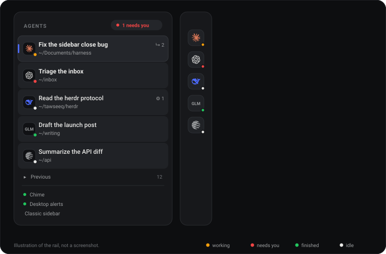

# dsh-agent-rail

English | [中文](README.zh.md)

A folder-free left sidebar for [DeepSeek Harness](https://github.com/deepseek-ai). One row per live agent: provider mark, title, working directory, and the work it currently has in flight. Nothing is nested, nothing needs filing.

It replaces the native `sidebar.workspaces` region. There is an escape hatch back if you dislike it.



*Illustration of the states, not a screenshot: focused row with a brand bar, orange "working", red "needs you", green "finished", white "idle".*

## Why

Folders answer "where does this file live". Agents are a queue, not a filing cabinet: what matters is which one needs you, which is working, and what it is working on. So the list is flat, sorts by attention, and closing an agent removes it from the list instead of asking you to archive it.

- **Sort:** needs you → working → finished-unread → idle, then most recently updated.
- **Status dot:** white idle, pulsing orange working, red needs you, green finished while you were elsewhere.
- **Avatar:** the provider mark for the session — Claude, DeepSeek, OpenAI, Kimi, Qwen, Gemini, Mistral. A model without a local mark falls back to its family label (`GLM`), and a session with no recorded model falls back to its title initials.
- **Work in flight:** `↳ N` running subagents, `⚙ N` running background jobs, with their labels in the hover.
- **Focused row:** the session actually open in the main pane gets a brand bar, a raised fill and a bolder title.

## Keyboard

| Keys | Action |
| --- | --- |
| `Alt N` | New agent |
| `Alt ↓` / `Alt ↑` | Next / previous agent in the visible order |
| `Alt A` | Jump to the next agent waiting on you |

These are **in-app actions only**. Nothing is written to Hyprland, the OS, or DSH's global shortcut settings: the keys are read by the plugin while the DSH tab has focus, and released when focus leaves. They are listed in DSH's shortcut reference under the read-only *application* group.

They are ignored while an input method is composing, while a modal is open, inside a terminal pane, and whenever another control already handled the key — so the composer keeps its own `Alt+↑/↓` line-move bindings.

## Closing and resuming

The `×` on a row archives the session through the native DSH action and drops it out of the list immediately. Running or waiting agents cannot be closed; the button stays disabled until the turn ends, so nothing is killed silently.

A collapsed **Previous** row appears at the foot of the list whenever anything is closed. Expand it to see the last 15 closed agents and click one to unarchive and reopen it. `Alt+↑/↓` never lands on a closed agent.

**Classic sidebar** at the foot unregisters this view and reveals the untouched native browser, including search and full history. While classic mode is on, an **Agents** row appears at the sidebar foot to switch back.

## Notifications

- **In the list:** the red dot, plus a `N need you` pill that cycles through the agents waiting on you.
- **Toast:** a card at the top right when an agent becomes blocked on a question or approval, or finishes while you are elsewhere. Click it to open that agent.
- **Chime:** a two-note Web Audio tone — rising for "needs you", falling for "done". Toggling **Chime** in the footer plays a sample. Browsers refuse to start audio before a gesture, so the context unlocks on your first click or keypress; no audio is possible before that.
- **Desktop alerts:** optional, off by default. The footer toggle asks the browser for notification permission and then raises a system notification only while the tab is in the background.

Nothing fires on page load — only real transitions after the app is open.

## Install

```sh
# from npm (once published)
dsh plugin --profile web add dsh-agent-rail

# from a checkout
dsh plugin --profile web add link:/absolute/path/to/dsh-agent-rail
```

Then hard-refresh the page (Ctrl/Cmd+Shift+R). Reload the tab again if the host had to restart for the bundle.

## Compatibility

Built against DSH `0.2.2-rc.1`. The sidebar slot contract is still moving, so:

- the plugin replaces `sidebar.workspaces` at priority `-50` and never touches the native shell, tools or settings around it;
- an error boundary wraps the view — if a DSH upgrade breaks it, you get a working **Classic sidebar** button instead of a blank column;
- if the slot disappears entirely, the plugin simply stays inactive and the native browser renders.

## How it works

- Registers the region through `ctx.slots`, reads session state through `ctx.sessions.list` and `ctx.uiSession.sessionStatus`, and navigates with `ctx.uiWorkspace`.
- Reads only documented session projections (`agentPreset`, `modelSelection`, `subagentCatalog`); jobs come from `ctx.jobs` with reference-counted per-agent roster streams, capped at ten watched agents.
- No core patches, no Host routes, no session-format changes, no network requests. Preferences live in `localStorage` under `dsh.agent-rail.v1`.

## Development

```sh
npm run check   # manifest, assets, locale metadata, no machine paths
```

No build step: `client.js` is a plain module in the DSH client module format. DSH builds each client bundle once per entry, so after editing `client.js` you must restart the plugin row (toggle it off and on in Plugins) — a page refresh alone serves the old bundle.

Constraints kept deliberately: zero dependencies, no imports of other DSH client packages, theme tokens for every color, no DOM writes outside the component.

## License

MIT. Brand marks are inlined from [Simple Icons](https://simpleicons.org) (CC0); the marks themselves remain trademarks of their owners and are used only to identify the model a session runs.
