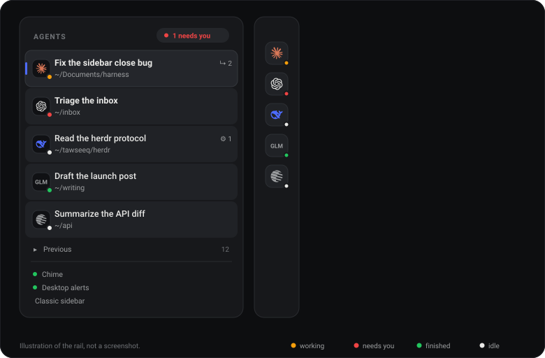

# dsh-agent-rail

[English](README.md) | 中文

一个没有文件夹的左栏，为 [DeepSeek Harness](https://github.com/deepseek-ai) 而做。每个在线智能体一行：服务商标记、标题、工作目录，以及它手上正在跑的事。不嵌套，不需要归档整理。

它替换原生的 `sidebar.workspaces` 区域；不喜欢的话，随时可以切回去。



*这是状态示意图，不是截图：聚焦行带品牌色侧条，橙色表示进行中，红色表示需要你，绿色表示已完成，白色表示空闲。*

## 为什么

文件夹回答的是"文件该放哪儿"。智能体是一条队列，不是一个文件柜：真正重要的是谁在等你、谁在忙、在忙什么。所以列表是扁平的，按注意力排序，关闭一个智能体就是让它从列表里消失，而不是先问你打不打算归档。

- **排序：** 需要你 → 进行中 → 新完成 → 空闲，同级再按最近更新。
- **状态点：** 白色空闲，橙色脉冲进行中，红色需要你，绿色是你不在时完成了。
- **头像：** 会话所用模型的服务商标记 —— Claude、DeepSeek、OpenAI、Kimi、Qwen、Gemini、Mistral。没有本地标记的模型回退到家族名（如 `GLM`），连模型都还没记录的会话回退到标题首字母。
- **正在跑的事：** `↳ N` 个运行中的子智能体、`⚙ N` 个运行中的后台任务，悬停可见具体名称。
- **聚焦行：** 主面板真正打开的那个会话，带品牌色侧条、提升的背景和更粗的标题。

## 键盘

| 按键 | 动作 |
| --- | --- |
| `Alt N` | 新建智能体 |
| `Alt ↓` / `Alt ↑` | 下一个 / 上一个智能体（按可见顺序） |
| `Alt A` | 跳到下一个等你的智能体 |

这些**只是应用内动作**。不会写入 Hyprland、系统或 DSH 的全局快捷键设置：只有当 DSH 标签页获得焦点时插件才读取这些键，失焦即释放。它们会出现在 DSH 快捷键参考的只读 *application* 分组里。

在输入法组字、弹窗打开、终端面板内，以及别的控件已经处理了该按键时，都会被忽略 —— 所以输入框保留它自己的 `Alt+↑/↓` 换行绑定。

## 关闭与恢复

行上的 `×` 通过 DSH 原生动作归档会话，并立即从列表里消失。正在运行或等待回答的智能体不能关闭；按钮会一直禁用直到这一回合结束，不会静默杀掉任何东西。

只要有东西被关闭，列表底部就会出现一行折叠的 **Previous**。展开可以看到最近 15 个已关闭的智能体，点击其中一个即可取消归档并重新打开。`Alt+↑/↓` 永远不会落在已关闭的智能体上。

底部的 **Classic sidebar** 会注销本视图，露出未被改动的原生浏览器（含搜索和完整历史）。处于经典模式时，侧栏底部会出现 **Agents** 行，点一下切回来。

## 通知

- **列表内：** 红点，以及一个 `N 个需要你` 的胶囊，点击可在等待你的智能体之间循环。
- **提示卡：** 智能体因提问或审批而阻塞，或者你不在时它完成了，右上角会出现卡片，点击直达该智能体。
- **提示音：** Web Audio 的两音提示 —— 上行表示"需要你"，下行表示"完成"。点侧栏底部的 **Chime** 会播放一次示例。浏览器在用户手势之前不允许发声，所以首次点击或按键时解锁音频；在那之前不会有声音。
- **桌面通知：** 可选，默认关闭。底部开关会请求浏览器的通知权限，之后只在标签页处于后台时发出系统通知。

页面加载时不会触发任何通知 —— 只有应用打开之后发生的真实状态变化。

## 安装

```sh
# 从 npm 安装（发布后）
dsh plugin --profile web add dsh-agent-rail

# 从本地检出安装
dsh plugin --profile web add link:/绝对路径/dsh-agent-rail
```

然后强制刷新页面（Ctrl/Cmd+Shift+R）。如果宿主因为加载 bundle 需要重启，再刷新一次标签页。

## 兼容性

针对 DSH `0.2.2-rc.1` 构建。侧栏插槽的契约仍在演进，因此：

- 插件以优先级 `-50` 替换 `sidebar.workspaces`，不触碰周围的原生外壳、工具与设置；
- 视图外面包了一层错误边界 —— 如果 DSH 升级把它弄坏了，你会得到一个可用的 **Classic sidebar** 按钮，而不是空白的一栏；
- 如果插槽整个消失，插件保持未激活，原生浏览器照常渲染。

## 实现方式

- 通过 `ctx.slots` 注册这个区域，通过 `ctx.sessions.list` 和 `ctx.uiSession.sessionStatus` 读取会话状态，用 `ctx.uiWorkspace` 做导航。
- 只读文档化的会话投影（`agentPreset`、`modelSelection`、`subagentCatalog`）；后台任务来自 `ctx.jobs`，按引用计数订阅每个智能体的清单流，最多同时观察十个。
- 没有核心补丁、没有 Host 路由、没有会话格式改动、没有网络请求。偏好保存在 `localStorage` 的 `dsh.agent-rail.v1` 下。

## 开发

```sh
npm run check   # 清单、资源、locale 元数据、绝对路径
```

没有构建步骤：`client.js` 就是 DSH 客户端模块格式的普通模块。DSH 对每个条目只构建一次客户端 bundle，所以改完 `client.js` 必须在插件面板里把该行关掉再打开（仅仅刷新页面会继续提供旧 bundle）。

刻意保持的约束：零依赖、不 import 其他 DSH 客户端包、所有颜色走主题 token、不在组件之外写 DOM。

## 许可证

MIT。服务商标记内联自 [Simple Icons](https://simpleicons.org)（CC0）；标记本身仍归各自所有者，仅用于标识会话所运行的模型。
